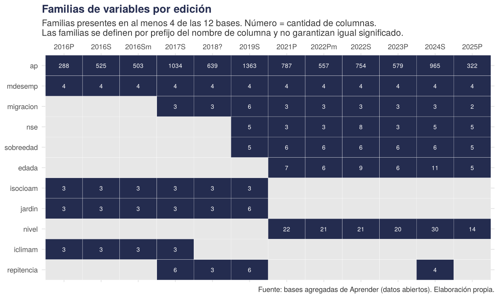

# Catálogo y auditoría de las bases agregadas de Aprender (2016-2025)

> **Elaboración propia a partir de datos abiertos. No es una publicación oficial de la Secretaría de Educación de la Nación ni refleja su posición.**

> **Estado: análisis v0.x, en construcción.** Fases 1 a 6 completas (inventario, claves, desempeño, NSE, familias, diccionario e informe en Quarto). Informe publicado como página web: https://friedsam-r.github.io/aprender-auditoria-serie/reports/informe.html

## Pregunta

Entre las 12 bases agregadas de Matemática de Aprender publicadas como datos abiertos, ¿qué elementos (claves geográficas, categorías, columnas de desempeño, nivel socioeconómico y familias de variables) se pueden armonizar entre ediciones, y cuáles no?

Es una **auditoría de los archivos**, no un análisis de resultados: no se compara el desempeño entre ediciones.

## Resultado principal



El informe incluye una guía de compatibilidad con la evidencia de cada hallazgo (por ejemplo, que hasta 2019 la columna de provincia guarda nombres con ortografías distintas, que una base tiene 23 jurisdicciones, o que el nivel socioeconómico tiene tres definiciones). Está en [`reports/informe.html`](reports/informe.html).

## Datos

Las 12 bases de Matemática de Aprender (2016 a 2025) y el diccionario de variables, de los datos abiertos de la Secretaría de Educación de la Nación. Los datos **no se incluyen**: las instrucciones de descarga están en [`data/README.md`](data/README.md).

## Método

Reglas fijadas antes de calcular y hechos verificados que el código debe reproducir, en [`docs/diseno_proyecto_3.md`](docs/diseno_proyecto_3.md). Cada script frena con un error si un hecho no coincide.

## Cómo reproducir

1. Descargar los archivos como indica [`data/README.md`](data/README.md) y guardarlos en `data/raw/`.
2. Desde la raíz del proyecto, con una sesión de R en UTF-8:

```bash
Rscript R/01_inventario.R
Rscript R/02_claves.R
Rscript R/03_desempeno.R
Rscript R/04_nse.R
Rscript R/05_familias.R
Rscript R/06_diccionario.R
quarto render reports/informe.qmd
```

Probado con R 4.3.3 (readr 2.1.5, dplyr 1.1.4, tidyr 1.3.1, ggplot2 3.4.4, readxl 1.4.3) y con R 4.6.0, con las mismas cifras en las seis fases (las versiones de los paquetes en cada ejecución figuran al pie del informe). Usa paquetes del tidyverse.

## Limitaciones

Ver la sección 6 de [`docs/diseno_proyecto_3.md`](docs/diseno_proyecto_3.md).

## Autor

Carlos Friedsam · [LinkedIn](https://www.linkedin.com/in/carlos-friedsam-93709513b/)

## Licencia

El código se distribuye bajo licencia MIT (ver [`LICENSE`](LICENSE)). Los datos de origen no se incluyen y se rigen por los términos de uso del portal de datos abiertos de la Secretaría de Educación de la Nación; conviene verificarlos antes de reutilizarlos.
